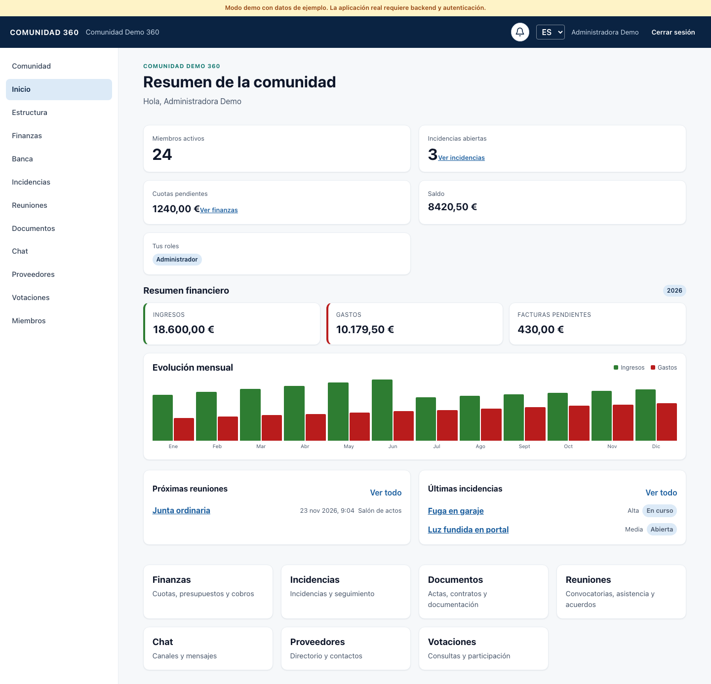
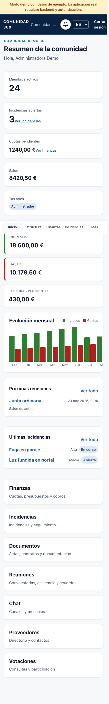

# COMUNIDAD 360

[](https://github.com/elenaalmansacampos/comunidad360/actions/workflows/ci.yml)
[](https://github.com/elenaalmansacampos/comunidad360/actions/workflows/security.yml)
[](https://elenaalmansacampos.github.io/comunidad360/)

Plataforma SaaS multi-comunidad para gestionar comunidades de propietarios: estructura, titulares,
cuotas, cobros, incidencias, documentos, reuniones, notificaciones y participación.

> **Demo pública:** <https://elenaalmansacampos.github.io/comunidad360/>  
> La demo usa datos de ejemplo en el navegador. La aplicación real funciona contra el backend Spring
> Boot y PostgreSQL.



## ¿Para qué sirve?

COMUNIDAD 360 centraliza la administración de una comunidad de propietarios y sustituye la
dispersión de hojas de cálculo, correos, WhatsApp y carpetas locales por un único espacio con
permisos, trazabilidad y datos consistentes.

Sirve para:

- **Administradores de fincas y juntas**: gestionar varias comunidades desde un mismo producto,
  con separación estricta de datos.
- **Presidentencia, secretaría y tesorería**: preparar presupuestos, emitir cuotas, controlar
  cobros, convocar reuniones, registrar acuerdos y publicar actas.
- **Propietarios**: consultar su deuda, incidencias, documentos, reuniones y votaciones.
- **Inquilinos**: acceder solo a la información permitida de su unidad.
- **Proveedores**: mantener un directorio de contactos y servicios de la comunidad.

Problemas que resuelve:

- Saber quién debe cuánto y desde cuándo.
- Evitar cargos duplicados y descuadres de coeficientes.
- Tener las actas, contratos y estatutos localizables y versionados.
- Dar transparencia sin exponer datos de otros propietarios.
- Dejar rastro de quién consulta, descarga, modifica o vota.
- Trabajar en español y catalán, también desde el móvil.

## Demo

| Escritorio | Móvil |
| --- | --- |
|  |  |

- **Demo pública:** <https://elenaalmansacampos.github.io/comunidad360/>
- **Demo local:** `http://localhost:13000`
- **Usuario:** `admin@comunidad360.local`
- **Contraseña:** `Admin1234!`

La demo de Pages es una vista con datos de ejemplo y sin backend real. Para probar la aplicación
completa, usa Docker Compose en local.

## Módulos

| Módulo | Qué incluye |
| --- | --- |
| Estructura | Edificios, viviendas, locales, garajes, trasteros, elementos comunes y coeficientes |
| Titularidad | Propietarios, copropiedad, porcentajes, inquilinos e histórico |
| Finanzas | Ejercicios, presupuestos, cuotas, derramas, cargos, facturas, pagos y apuntes |
| Banca | Cuentas enmascaradas, importación CSV, movimientos y conciliación |
| Incidencias | Prioridades, estados, asignación, comentarios, fotos e histórico |
| Documentos | Categorías, visibilidad, versiones, S3 y URL firmada |
| Reuniones | Convocatorias, orden del día, asistencia, acuerdos y actas |
| Notificaciones | Campana, preferencias, email y idioma del destinatario |
| Dashboard | Indicadores por rol, evolución mensual e informe PDF |
| Proveedores | Directorio, contactos y estado |
| Chat | Canal general, temáticos y privados con mensajes persistidos |
| Votaciones | Consultas informativas, elegibilidad, coeficiente, voto único y resultados |

## Estado del proyecto

**FASE 3 completada y FASE 4 en validación técnica.**

- Backend: 55 tests.
- Frontend: 28 tests.
- E2E: 3 tests de escritorio, móvil y accesibilidad.
- CodeQL, Gitleaks, Dependency Review y Dependabot activos.
- Backup/restore cifrado verificado.
- CI y Security en verde.

Pendiente para el piloto real: validación legal LPH/RGPD, infraestructura con HTTPS y secretos,
pentest, auditoría manual de accesibilidad, backups offsite y usuarios reales.

## Arquitectura

- **Monolito modular** Spring Boot con módulos por dominio.
- **Multi-tenant** por `community_id`, permisos backend y FKs compuestas.
- **Frontend SPA** React + TypeScript.
- **PostgreSQL** con Flyway.
- **S3 compatible** para archivos, con almacenamiento local en desarrollo.
- **SMTP** con Mailpit en desarrollo.
- **ClamAV opcional** para análisis antimalware.
- **Docker Compose** para desarrollo y demo.

```text
React SPA → Nginx → Spring Boot → PostgreSQL
                         ├── S3
                         ├── SMTP
                         └── ClamAV
```

## Stack

| Capa | Tecnología |
| --- | --- |
| Frontend | React 18, TypeScript, Vite 8, React Router 7, TanStack Query, Zustand, Sass, i18next, Vitest, Playwright |
| Backend | Java 21, Spring Boot 3.3, Spring Security, Spring Data JPA, Flyway, Maven |
| Datos | PostgreSQL 16 |
| Infraestructura | Docker, Docker Compose, S3 compatible, SMTP, ClamAV opcional |
| Calidad | JUnit 5, Testcontainers, CodeQL, Gitleaks, Dependabot, GitHub Actions |

## Arranque local

Requisitos: Docker y Docker Compose.

```bash
FRONTEND_HTTP_PORT=13000 BACKEND_HTTP_PORT=18080 docker compose --profile app up -d --build
```

La demo queda en:

- Frontend: <http://localhost:13000>
- Backend: <http://localhost:18080>
- Mailpit: <http://localhost:8025>
- S3Mock: <http://localhost:9090>

Puedes cambiar `FRONTEND_HTTP_PORT` y `BACKEND_HTTP_PORT` si están ocupados.

Credenciales de desarrollo:

```text
admin@comunidad360.local
Admin1234!
```

Para detener:

```bash
docker compose --profile app down
```

## Desarrollo

### Backend

```bash
cd backend
JAVA_HOME=/opt/homebrew/opt/openjdk@21/libexec/openjdk.jdk/Contents/Home mvn spring-boot:run
```

Tests:

```bash
cd backend
mvn test
```

### Frontend

```bash
cd frontend
npm ci
npm run dev
```

Validaciones:

```bash
npm run typecheck
npm test
npm run build
npm run check:i18n
npm run test:e2e
```

### Backup cifrado

```bash
export BACKUP_PASSPHRASE='...'
scripts/backup-encrypted.sh
scripts/restore-encrypted.sh <archivo.dump.enc> comunidad360_restore_test
```

Instalación del timer diario:

```bash
sudo scripts/install-systemd-backup.sh
```

Ver [`docs/BACKUP.md`](docs/BACKUP.md).

## GitHub Pages

El workflow [`Deploy demo to GitHub Pages`](.github/workflows/pages.yml) publica el frontend en:

**<https://elenaalmansacampos.github.io/comunidad360/>**

La build usa `VITE_BASE_PATH=/comunidad360/` y `VITE_DEMO_MODE=true`. Para conectar la app real
desde Pages hace falta un backend público con HTTPS y configurar su URL de API; por seguridad no se
incluyen credenciales ni backend en el repositorio.

## Seguridad y calidad

- Aislamiento multi-tenant probado en todos los módulos.
- JWT + refresh cookie `HttpOnly`.
- Rate limiting de autenticación y perimetral.
- CSP, Permissions-Policy, X-Frame-Options y Referrer-Policy.
- Antimalware ClamAV opcional y fail-closed.
- Auditoría de operaciones sensibles.
- CodeQL y Gitleaks en CI.
- Backups cifrados con AES-256.

Ver [`docs/SECURITY.md`](docs/SECURITY.md) y [`docs/FASE4-VALIDATION.md`](docs/FASE4-VALIDATION.md).

## Documentación

| Documento | Contenido |
| --- | --- |
| [`docs/SPEC.md`](docs/SPEC.md) | Alcance, requisitos, roles y criterios de éxito |
| [`docs/ARCHITECTURE.md`](docs/ARCHITECTURE.md) | Arquitectura, multi-tenancy, módulos y despliegue |
| [`docs/DATABASE.md`](docs/DATABASE.md) | Modelo ER, diccionario de datos e integridad |
| [`docs/API.md`](docs/API.md) | Convenciones y catálogo de endpoints |
| [`docs/SECURITY.md`](docs/SECURITY.md) | Seguridad, RGPD/LOPDGDD, LPH y permisos |
| [`docs/DESIGN-SYSTEM.md`](docs/DESIGN-SYSTEM.md) | Identidad visual, componentes y accesibilidad |
| [`docs/ROADMAP.md`](docs/ROADMAP.md) | Fases, dependencias y criterios de salida |
| [`docs/BACKLOG.md`](docs/BACKLOG.md) | Épicas, historias y criterios de aceptación |
| [`docs/FASE1-DESIGN.md`](docs/FASE1-DESIGN.md) | Decisiones de diseño |
| [`docs/WIREFRAMES.md`](docs/WIREFRAMES.md) | Navegación y wireframes mobile-first |
| [`docs/openapi.yaml`](docs/openapi.yaml) | Contrato OpenAPI |
| [`docs/FASE2-IMPLEMENTATION.md`](docs/FASE2-IMPLEMENTATION.md) | Fundaciones técnicas |
| [`docs/FASE3.1-IMPLEMENTATION.md`](docs/FASE3.1-IMPLEMENTATION.md) | Estructura |
| [`docs/FASE3.2-IMPLEMENTATION.md`](docs/FASE3.2-IMPLEMENTATION.md) | Titularidad e inquilinos |
| [`docs/FASE3.3-IMPLEMENTATION.md`](docs/FASE3.3-IMPLEMENTATION.md) | Finanzas |
| [`docs/FASE3.4-IMPLEMENTATION.md`](docs/FASE3.4-IMPLEMENTATION.md) | Banca |
| [`docs/FASE3.5-IMPLEMENTATION.md`](docs/FASE3.5-IMPLEMENTATION.md) | Incidencias |
| [`docs/FASE3.6-IMPLEMENTATION.md`](docs/FASE3.6-IMPLEMENTATION.md) | Documentos y S3 |
| [`docs/FASE3.7-IMPLEMENTATION.md`](docs/FASE3.7-IMPLEMENTATION.md) | Reuniones y notificaciones |
| [`docs/FASE3.8-IMPLEMENTATION.md`](docs/FASE3.8-IMPLEMENTATION.md) | Dashboard e informes |
| [`docs/FASE3.9-IMPLEMENTATION.md`](docs/FASE3.9-IMPLEMENTATION.md) | MVP+ |
| [`docs/FASE4-VALIDATION.md`](docs/FASE4-VALIDATION.md) | Validación, E2E, seguridad y carga |
| [`docs/DEPLOYMENT.md`](docs/DEPLOYMENT.md) | Despliegue de producción |
| [`docs/PILOT-RUNBOOK.md`](docs/PILOT-RUNBOOK.md) | Operación del piloto |
| [`docs/BACKUP.md`](docs/BACKUP.md) | Backups cifrados y restauración |
| [`docs/ADR/`](docs/ADR/) | Decisiones arquitectónicas |
| [`CONTRIBUTING.md`](CONTRIBUTING.md) | Convenciones de contribución |

## Estructura del repositorio

```text
.
├── backend/             # Spring Boot + Flyway + tests
├── frontend/            # React + Vite + i18n + tests + E2E
├── docs/                # Especificación, arquitectura, fases y capturas
├── deploy/systemd/      # Timer de backups
├── scripts/             # Backups, carga, i18n y utilidades
├── .github/workflows/   # CI, Security y Pages
├── docker-compose.yml
└── README.md
```

## Limitaciones conocidas

- Chat con polling; WebSocket/STOMP pendiente.
- Sin adjuntos ni moderación de chat.
- Proveedores aún no vinculados a incidencias/facturas.
- Votaciones consultivas, sin voto secreto ni quórum legal.
- Sin push notifications.
- Documentos sin antivirus obligatorio por defecto; ClamAV es opcional.
- Sin app móvil nativa; la web es responsive e instalable como PWA.
- La demo de Pages no tiene backend real.

## Licencia

Pendiente de decisión. No se distribuye licencia hasta que el titular del producto lo determine.
