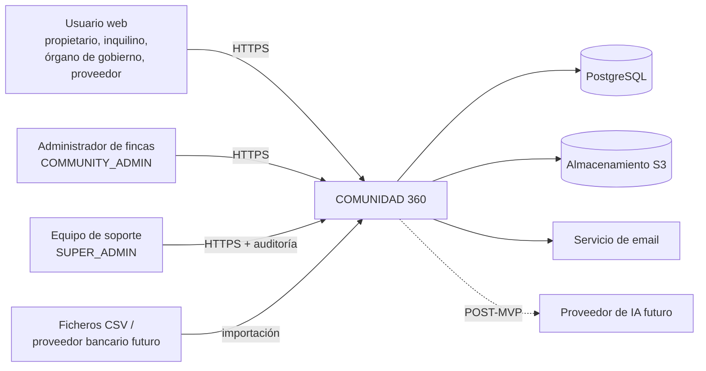
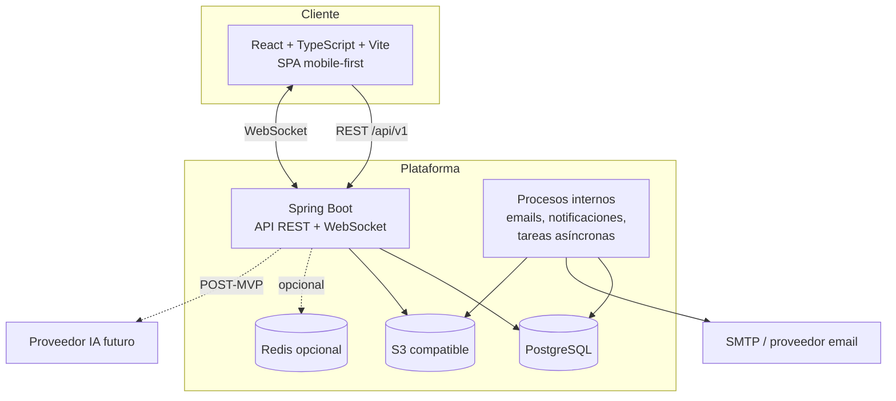
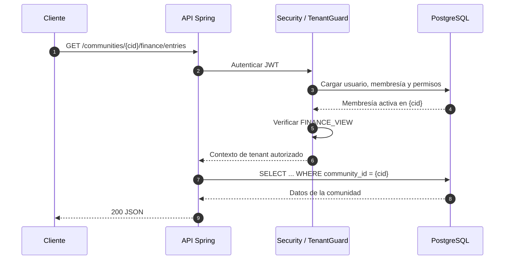
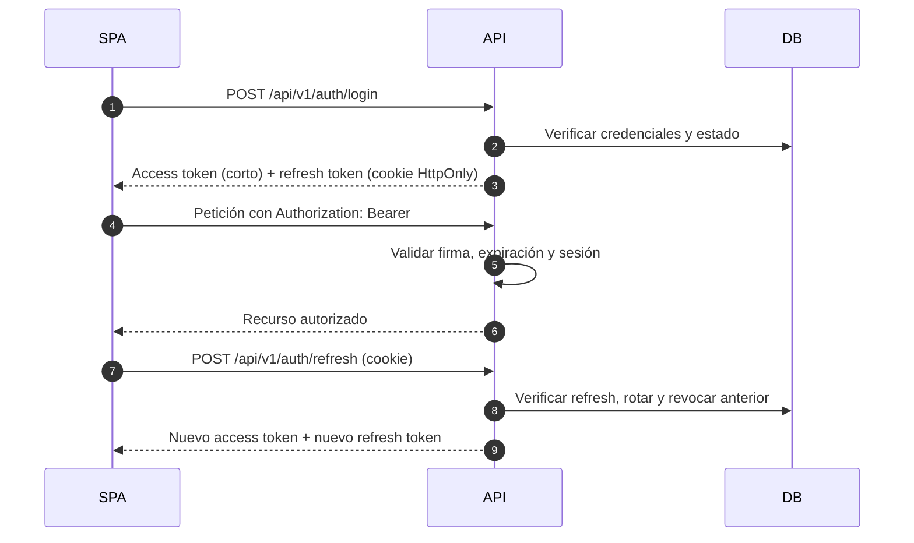

# COMUNIDAD 360 — Arquitectura técnica

| Campo | Valor |
| --- | --- |
| Versión | 0.1.0 |
| Estado | Propuesta para validación (FASE 0) |
| Fecha | 2026-11-19 |
| Documentos relacionados | `SPEC.md`, `DATABASE.md`, `API.md`, `SECURITY.md`, `ADR/` |

---

## 1. Principios

1. **Monolito modular**: un único despliegue backend con módulos de negocio bien delimitados.
2. **Aislamiento multi-tenant en backend**: ninguna consulta de negocio sin contexto de comunidad.
3. **Seguridad por defecto**: autorización explícita, mínimo privilegio y auditoría.
4. **Mobile-first**: el frontend se diseña primero para móvil y se adapta a escritorio.
5. **Bilingüe desde el MVP**: español y catalán con arquitectura extensible a más idiomas.
6. **Simplicidad operativa**: Docker Compose en desarrollo y despliegue inicial sencillo.
7. **Verificabilidad**: cada decisión debe poder probarse de forma automatizada.
8. **Evolución sin sobreingeniería**: Redis, colas y microservicios solo cuando exista necesidad
   demostrada.

## 2. Vista de contexto



Actores y límites:

- El navegador nunca es una frontera de seguridad.
- PostgreSQL, el almacenamiento de objetos y el proveedor de email son infraestructura gestionada por la
  plataforma.
- La integración bancaria del MVP se limita a importación CSV iniciada por un usuario autorizado.

## 3. Vista de contenedores



Decisiones:

- **Un solo backend Spring Boot** con módulos internos. No hay microservicios en el MVP.
- **Worker** como componente lógico dentro del mismo artefacto o proceso separado que reutiliza el mismo
  dominio. En el MVP puede ejecutarse con un planificador interno; se separará si la carga lo exige.
- **PostgreSQL** es la fuente de verdad del negocio.
- **S3 compatible** almacena documentos y adjuntos; la base de datos solo guarda metadatos.
- **Redis** es opcional y no forma parte del camino crítico del MVP. Se usa si se necesita rate limiting
  distribuido, caché o coordinación de WebSocket.

## 4. Estilo arquitectónico: monolito modular

### 4.1. Estructura de paquetes backend

```text
com.comunidad360
├── config
├── security
├── common
├── auth
├── user
├── community
├── building
├── property
├── membership
├── communication
├── chat
├── finance
├── banking
├── incidents
├── documents
├── meetings
├── voting
├── providers
├── notifications
├── ai
└── audit
```

Cada módulo de negocio se organiza por capas:

```text
<module>
├── controller
├── service
├── repository
├── entity
├── dto
├── mapper
├── exception
└── validation
```

### 4.2. Reglas de dependencia

1. `controller` → `service` → `repository` → `entity`.
2. `dto` y `mapper` se usan en la frontera; las entidades no se exponen en la API.
3. Un módulo no accede directamente a los repositorios de otro módulo.
4. La comunicación entre módulos se hace mediante interfaces de servicio públicas del módulo.
5. `common` y `security` no dependen de módulos de negocio.
6. Prohibidas las dependencias circulares; se validan con ArchUnit.
7. Los eventos de dominio se usan para desacoplar notificaciones, auditoría y tareas posteriores.
8. `audit` recibe eventos o llamadas explícitas; no debe convertirse en dependencia de todos los módulos.

### 4.3. Alternativas descartadas

| Alternativa | Ventajas | Inconvenientes | Decisión |
| --- | --- | --- | --- |
| Microservicios desde el inicio | Escalado independiente | Complejidad operativa, transacciones distribuidas, equipo pequeño | Descartado |
| Monolito sin módulos | Simplicidad inicial | Acoplamiento, difícil mantenimiento | Descartado |
| Monolito modular | Límites claros, un despliegue, evolución gradual | Disciplina de módulos necesaria | **Elegido** |

Ver `ADR/ADR-0001-monolito-modular.md`.

## 5. Multi-tenancy

### 5.1. Estrategia elegida

**Base de datos compartida, esquema compartido y discriminador `community_id`** en todas las tablas de
negocio, con defensa en profundidad:

1. **Autenticación**: identifica al usuario.
2. **Resolución de tenant**: la comunidad se obtiene de la ruta (`/api/v1/communities/{communityId}/...`)
   o de la membresía activa, y se valida contra la base de datos.
3. **Guard de autorización**: verifica membresía activa y permiso concreto para la operación.
4. **Repositorios tenant-aware**: toda consulta incluye `community_id`; las entidades de negocio heredan
   de una base con el identificador de comunidad.
5. **Restricciones de integridad**: claves foráneas compuestas por `(id, community_id)` para impedir
   referencias cruzadas entre comunidades.
6. **Pruebas de aislamiento**: cada módulo con datos debe tener pruebas que intenten acceder a recursos
   de otra comunidad y esperen `403`/`404`.
7. **Endurecimiento opcional**: Row Level Security (RLS) de PostgreSQL como segunda barrera, evaluada en
   FASE 2. No se considera sustituto de la autorización de aplicación.



### 5.2. Reglas obligatorias

- `community_id` es obligatorio en toda entidad de negocio.
- Nunca se acepta `community_id` como única prueba de autorización.
- Las entidades globales (`user`, catálogos de plataforma) no llevan `community_id`.
- Una persona puede tener varias membresías; los roles se evalúan por comunidad.
- `SUPER_ADMIN` no omite la auditoría ni la validación de parámetros.
- Los proveedores solo ven recursos asignados dentro de la comunidad.

### 5.3. Alternativas descartadas

| Alternativa | Ventajas | Inconvenientes | Decisión |
| --- | --- | --- | --- |
| Base de datos por comunidad | Aislamiento físico fuerte | Coste operativo y migraciones múltiples | Descartado para MVP |
| Esquema por comunidad | Aislamiento medio | Complejidad de migraciones y connection pooling | Descartado para MVP |
| Esquema compartido con `community_id` | Simplicidad, coste, migraciones únicas | Requiere disciplina y pruebas | **Elegido** |

Ver `ADR/ADR-0002-multitenancy.md`.

## 6. Autenticación y autorización

### 6.1. Flujo de autenticación



Decisiones:

- Access token JWT de corta duración (15 min propuesto).
- Refresh token rotatorio, almacenado como hash, con detección de reutilización.
- Refresh token en cookie `HttpOnly`, `Secure`, `SameSite=Lax` o `Strict` según dominio final.
- El access token no se persiste en `localStorage`; se mantiene en memoria.
- La revocación se apoya en una tabla de sesiones/refresh tokens; Redis es opcional.
- Los permisos se resuelven en servidor por comunidad. El JWT puede contener identificadores, pero no se
  confía en permisos embebidos sin validación.
- Contraseñas con Argon2id (preferido) o BCrypt; parámetros revisados en FASE 2.
- Rate limiting específico para login, recuperación y refresco.

Ver `ADR/ADR-0003-autenticacion-jwt.md`.

### 6.2. Autorización

- Catálogo de permisos + roles por comunidad + concesiones/denegaciones directas.
- Anotaciones o interceptores de autorización por caso de uso, no solo por URL.
- Verificación de pertenencia al recurso (por ejemplo, incidencia de la unidad del usuario).
- Pruebas negativas obligatorias: sin token, token caducado, rol insuficiente, recurso de otra comunidad,
  recurso de otra unidad.

## 7. Módulos y responsabilidades

| Módulo | Responsabilidad | Depende de |
| --- | --- | --- |
| `config` | Configuración transversal, propiedades, beans | — |
| `security` | Autenticación, autorización, tenant guard, JWT | `user`, `community`, `membership` |
| `common` | Errores, paginación, utilidades, eventos base | — |
| `auth` | Login, refresh, recuperación, verificación, invitaciones | `user`, `membership`, `notifications` |
| `user` | Datos de usuario, preferencias, idioma | `common` |
| `community` | Comunidad y configuración | `common` |
| `building` | Edificios | `community` |
| `property` | Unidades, elementos comunes, coeficientes | `community`, `building` |
| `membership` | Membresías, roles, permisos, titularidad e inquilinos | `user`, `community`, `property` |
| `communication` | Avisos y comunicaciones generales | `community`, `notifications` |
| `chat` | Canales, mensajes, adjuntos, moderación | `membership`, `documents`, `notifications` |
| `finance` | Ejercicios, presupuestos, cuotas, facturas, pagos, contabilidad | `community`, `property`, `membership`, `documents` |
| `banking` | Cuentas, importación CSV, movimientos, conciliación | `finance` |
| `incidents` | Incidencias, comentarios, adjuntos, estados | `community`, `property`, `membership`, `providers`, `documents` |
| `documents` | Documentos, versiones, permisos, auditoría de acceso | `community`, `membership` |
| `meetings` | Convocatorias, asistencia, acuerdos, actas | `community`, `membership`, `documents`, `notifications` |
| `voting` | Propuestas, elegibilidad, votos, resultados | `community`, `membership`, `meetings` |
| `providers` | Proveedores, contactos, categorías | `community` |
| `notifications` | Notificaciones, preferencias, email | `user`, `community` |
| `ai` | Futuras capacidades de IA | `documents`, `finance`, `incidents` |
| `audit` | Registro inmutable de operaciones | `common` |

Regla: `finance` no depende de `banking`; `banking` depende de `finance`. `documents` no depende de los
módulos que lo usan; ofrece una interfaz de almacenamiento y permisos.

## 8. Comunicación y procesamiento asíncrono

### 8.1. API REST

- Base: `/api/v1`.
- JSON con `camelCase`.
- Errores RFC 7807 con `code`, `messageKey`, `params`, `traceId`.
- Paginación y filtros homogéneos.
- Idempotencia en operaciones financieras.
- OpenAPI generado y versionado.

Ver `API.md`.

### 8.2. WebSocket

- Endpoint `/ws` con autenticación por token.
- STOMP sobre WebSocket.
- Suscripción por comunidad y canal, validando membresía.
- En el MVP, sin broker externo. Si se escala horizontalmente, usar broker compatible o Redis pub/sub.

Ver `ADR/ADR-0007-chat-websocket.md`.

### 8.3. Eventos y outbox

Para evitar perder notificaciones y auditoría:

1. La operación de negocio y el evento se guardan en la misma transacción.
2. Un publicador interno procesa el outbox y envía emails/notificaciones.
3. Los consumidores son idempotentes.
4. Los fallos se reintentan con backoff y quedan registrados.

En el MVP puede implementarse un outbox en PostgreSQL y un planificador interno (`@Scheduled`). Redis o
un broker dedicado se introducirán si la carga o la fiabilidad lo requieren.

## 9. Arquitectura frontend

### 9.1. Estructura

```text
frontend/src/
├── app/            # bootstrap, router, providers, guards
├── assets/         # imágenes, iconos, fuentes
├── components/     # componentes reutilizables sin lógica de negocio
├── layouts/        # AuthLayout, AppLayout, MobileLayout
├── pages/          # composición de pantallas por ruta
├── features/       # módulos funcionales (auth, finance, incidents, ...)
├── hooks/          # hooks reutilizables
├── services/       # cliente HTTP, interceptores, WebSocket
├── store/          # estado global (Zustand) cuando sea necesario
├── styles/         # tokens, reset, utilidades, Sass
├── types/          # tipos compartidos
├── utils/          # formato de fechas, importes, permisos
└── locales/        # es/translation.json, ca/translation.json
```

Cada `feature` agrupa:

```text
features/finance/
├── api/            # llamadas al backend
├── components/     # componentes específicos
├── hooks/          # estado y consultas
├── pages/          # pantallas de la feature
├── schemas/        # validación
├── types/          # tipos
└── utils/          # lógica de presentación
```

### 9.2. Decisiones frontend

- **Vite + React + TypeScript**.
- **React Router** para rutas y guards de autenticación/rol.
- **TanStack Query** para estado de servidor, caché, reintentos e invalidación.
- **Zustand** solo para estado global de cliente (sesión, preferencias, UI), no para duplicar estado de
  servidor.
- **Recharts** para gráficos del dashboard.
- **Sass** con tokens y mixins; evitar CSS ad hoc duplicado.
- **i18next + react-i18next** con detección y persistencia de idioma.
- **Vitest + React Testing Library** para componentes y hooks.
- **Playwright** para flujos críticos E2E.
- Formularios con validación en cliente y servidor; nunca confiar solo en el cliente.

### 9.3. Gestión de sesión y permisos en cliente

- La sesión se inicializa consultando al backend.
- Los permisos recibidos se usan para ocultar acciones, no para autorizar.
- Si el backend devuelve `401`, se intenta refrescar una vez; si falla, se redirige a login.
- Si devuelve `403`, se muestra un estado de acceso denegado sin filtrar información.
- El cambio de comunidad activa invalida las consultas dependientes del tenant.

## 10. Datos, almacenamiento y ficheros

- PostgreSQL con migraciones Flyway.
- Importes `DECIMAL`/`BigDecimal`, nunca coma flotante.
- Documentos y adjuntos en S3 compatible con claves opacas y URLs firmadas.
- Metadatos de archivos en base de datos; contenido fuera.
- Análisis antivirus/malware antes de exponer un archivo (propuesto para MVP).
- Nombres de archivo saneados; nunca se usan directamente como ruta.
- Copias de seguridad de base de datos y objetos coordinadas.

Ver `DATABASE.md` y `ADR/ADR-0005-documentos-s3.md`.

## 11. Notificaciones y email

- Plantillas versionadas en español y catalán.
- Renderizado con el locale del destinatario y fallback a `es`.
- Envío asíncrono con reintentos.
- Registro de envíos, rebotes y errores.
- No incluir datos financieros sensibles en asuntos ni cuerpos de email.
- Preferencias por categoría y canal.
- Push queda para post-MVP.

## 12. Observabilidad

- Logs estructurados JSON con `traceId`, `userId`, `communityId`, `module` y resultado.
- No registrar secretos, tokens, contraseñas ni datos financieros completos.
- Métricas: latencia, errores, trabajos pendientes, emails fallidos, conexiones WebSocket.
- Health checks: `/actuator/health` (liveness/readiness) sin exponer detalles sensibles.
- Alertas mínimas: errores 5xx, fallos de backup, cola de outbox atascada.
- Auditoría de negocio separada de los logs técnicos.

## 13. Entornos y despliegue

| Entorno | Uso | Datos |
| --- | --- | --- |
| Local | Desarrollo | Datos sintéticos |
| Test/CI | Pruebas automatizadas | Testcontainers, datos efímeros |
| Staging | Validación previa | Datos anonimizados o sintéticos |
| Producción | Piloto y clientes | Datos reales con acceso restringido |

- Docker Compose para desarrollo y staging inicial.
- Variables de entorno y secretos fuera del repositorio.
- Migraciones Flyway ejecutadas de forma controlada antes del despliegue.
- CI: compilación, tests, análisis estático, análisis de dependencias, build de imágenes.
- CD: despliegue con backup previo y verificación de salud.
- No se despliega si fallan tests críticos o hay vulnerabilidades críticas sin mitigar.

## 14. Estrategia de pruebas

| Nivel | Backend | Frontend |
| --- | --- | --- |
| Unitario | JUnit 5 + Mockito | Vitest |
| Integración | Spring Boot Test + Testcontainers | React Testing Library + MSW |
| Contratos | OpenAPI + validación de esquemas | Tipos generados/validados |
| E2E | Playwright contra stack completo | Playwright |
| Seguridad | Pruebas de autorización e aislamiento | Pruebas de rutas y permisos |
| Regresión | Suites por módulo | Flujos críticos |

Pruebas obligatorias antes de considerar una tarea terminada:

- Aislamiento multi-tenant en cada módulo con datos.
- Autorización positiva y negativa por rol.
- Cálculos financieros y redondeos.
- Renderizado bilingüe y formatos regionales.
- Acceso a documentos y URLs firmadas.
- Flujo de invitación, login, refresco y recuperación.

## 15. Riesgos arquitectónicos

| Riesgo | Probabilidad | Impacto | Mitigación |
| --- | --- | --- | --- |
| Fuga de datos entre comunidades | Media | Crítico | Tenant guard, FKs compuestas, pruebas, revisión de código, RLS opcional |
| Complejidad financiera subestimada | Alta | Alto | Modelo separado, ADR, pruebas de redondeo, validación con la comunidad piloto |
| Alcance del MVP demasiado amplio | Alta | Alto | MoSCoW, MVP+ separado, entregas incrementales |
| WebSocket difícil de escalar | Media | Medio | STOMP, broker futuro, diseño desacoplado |
| Dependencia de proveedores | Media | Medio | Interfaces y configuración por entorno |
| Documentos maliciosos | Media | Alto | Validación, antivirus, URLs firmadas, cuarentena |
| Requisitos legales no validados | Media | Alto | Revisión legal antes de votaciones y retención |
| Deuda por permisos ad hoc | Media | Alto | Catálogo de permisos y pruebas desde FASE 2 |

## 16. Decisiones pendientes

- Estrategia exacta de dominios y cookies (Q-06).
- Proveedor de email y S3 (Q-05).
- Uso o no de RLS en producción.
- Necesidad real de Redis en el MVP.
- Mecanismo de antivirus.
- Estrategia de observabilidad gestionada.
- Validación legal de votaciones y retención.

## 17. ADR

- [`ADR-0001`](./ADR/ADR-0001-monolito-modular.md) — Monolito modular.
- [`ADR-0002`](./ADR/ADR-0002-multitenancy.md) — Multi-tenancy compartido.
- [`ADR-0003`](./ADR/ADR-0003-autenticacion-jwt.md) — JWT y refresh tokens.
- [`ADR-0004`](./ADR/ADR-0004-modelo-financiero.md) — Modelo financiero y precisión decimal.
- [`ADR-0005`](./ADR/ADR-0005-documentos-s3.md) — Documentos en almacenamiento de objetos.
- [`ADR-0006`](./ADR/ADR-0006-i18n.md) — Internacionalización.
- [`ADR-0007`](./ADR/ADR-0007-chat-websocket.md) — Chat con WebSocket/STOMP.

---

*Fin de docs/ARCHITECTURE.md — v0.1.0 (FASE 0).*
