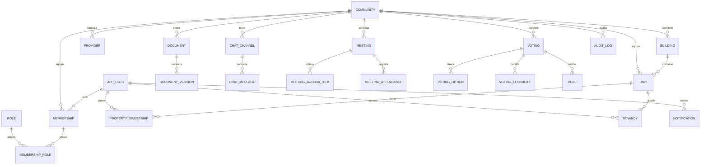
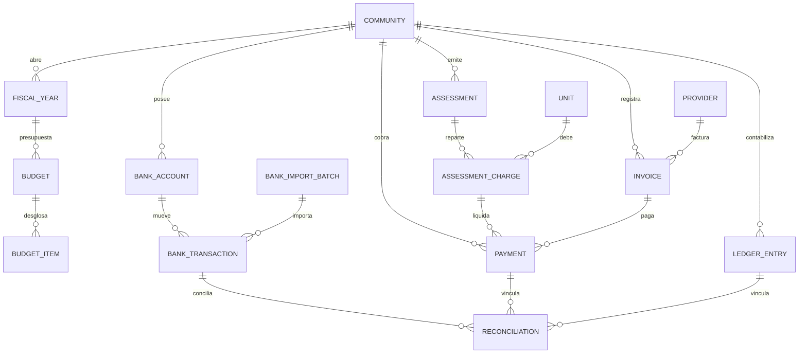

# COMUNIDAD 360 — Modelo de datos

| Campo | Valor |
| --- | --- |
| Versión | 0.1.0 |
| Estado | Modelo inicial para validación (FASE 0) |
| Fecha | 2026-11-19 |
| Motor | PostgreSQL 16+ (versión exacta a fijar en FASE 2) |
| Migraciones | Flyway |

---

## 1. Principios

1. **Multi-tenant por `community_id`** en todas las tablas de negocio.
2. **Integridad referencial compuesta** para impedir referencias entre comunidades.
3. **Importes con `NUMERIC`** y `BigDecimal`; nunca coma flotante.
4. **Trazabilidad**: marcas temporales, auditoría y versionado optimista.
5. **Borrado lógico** para entidades con historial; prohibido borrar registros financieros y de auditoría.
6. **Separación de conceptos financieros**: banco, contabilidad, factura, pago y cargo.
7. **Datos personales minimizados** y con finalidad documentada.
8. **Migraciones reproducibles** y revisadas; sin cambios manuales en producción.

## 2. Convenciones

| Aspecto | Convención |
| --- | --- |
| Nombres de tablas | `snake_case`, plural |
| Nombres de columnas | `snake_case` |
| Claves primarias | `id UUID` generado por la aplicación |
| Fechas y horas | `TIMESTAMPTZ` en UTC |
| Fechas de negocio | `DATE` |
| Importes | `NUMERIC(19,4)` |
| Coeficientes y porcentajes | `NUMERIC(9,6)` / `NUMERIC(7,4)` |
| Booleanos | `BOOLEAN NOT NULL DEFAULT false` |
| Enumeraciones | `VARCHAR` + `CHECK` (evita migraciones costosas de tipos) |
| Texto libre | `TEXT` con límite validado en aplicación |
| Optimistic locking | columna `version BIGINT` |
| Auditoría técnica | `created_at`, `updated_at`, `created_by`, `updated_by` cuando aplique |
| Zona horaria | `Europe/Madrid` por defecto, configurable por comunidad |
| Moneda | `EUR` en el MVP |
| Email | `VARCHAR(320)`, normalizado a minúsculas |
| Hash de token | `VARCHAR(255)` |
| Hash de archivo | `VARCHAR(64)` SHA-256 hexadecimal |

No se usarán `ENUM` nativos de PostgreSQL en el MVP para facilitar la evolución. Los valores permitidos se
validan con `CHECK` y en la aplicación.

Los emails se normalizan a minúsculas en la capa de servicio. Los hashes se almacenan en hexadecimal como
`VARCHAR` para mantener compatibilidad con la validación de esquema de Hibernate.

## 3. Vista general



## 4. Modelo financiero



Reglas del modelo:

- `BANK_TRANSACTION` representa lo que dice el banco.
- `LEDGER_ENTRY` representa el apunte contable interno.
- `INVOICE` representa una factura de proveedor o documento equivalente.
- `PAYMENT` representa un cobro o pago registrado.
- `ASSESSMENT_CHARGE` representa la deuda de una unidad por una cuota o derrama.
- `RECONCILIATION` vincula un movimiento bancario con un pago o un apunte, nunca los fusiona.

## 5. Diccionario de datos

### 5.1. Identidad y acceso

#### `app_user`

| Columna | Tipo | Restricciones | Notas |
| --- | --- | --- | --- |
| `id` | UUID | PK | Generado por aplicación |
| `email` | VARCHAR(320) | UNIQUE, NOT NULL; normalizado a minúsculas |
| `password_hash` | VARCHAR(255) | NOT NULL | Argon2id/BCrypt |
| `full_name` | VARCHAR(200) | NOT NULL | |
| `preferred_language` | VARCHAR(10) | NOT NULL DEFAULT `'es'` | `es`, `ca`, futuros |
| `status` | VARCHAR(30) | CHECK | `PENDING_VERIFICATION`, `ACTIVE`, `SUSPENDED`, `DISABLED` |
| `email_verified_at` | TIMESTAMPTZ | NULL | |
| `last_login_at` | TIMESTAMPTZ | NULL | |
| `failed_login_attempts` | INTEGER | NOT NULL DEFAULT 0 | |
| `locked_until` | TIMESTAMPTZ | NULL | |
| `created_at` | TIMESTAMPTZ | NOT NULL | |
| `updated_at` | TIMESTAMPTZ | NOT NULL | |
| `version` | BIGINT | NOT NULL DEFAULT 0 | Optimistic locking |

#### `invitation`

| Columna | Tipo | Restricciones | Notas |
| --- | --- | --- | --- |
| `id` | UUID | PK | |
| `community_id` | UUID | FK → `community` | Tenant |
| `email` | VARCHAR(320) | NOT NULL; normalizado a minúsculas |
| `role_code` | VARCHAR(40) | FK → `role` | Rol inicial |
| `token_hash` | VARCHAR(255) | UNIQUE, NOT NULL | No almacenar token en claro |
| `expires_at` | TIMESTAMPTZ | NOT NULL | |
| `accepted_at` | TIMESTAMPTZ | NULL | Uso único |
| `invited_by_user_id` | UUID | FK → `app_user` | |
| `created_at` | TIMESTAMPTZ | NOT NULL | |

#### `refresh_token`

| Columna | Tipo | Restricciones | Notas |
| --- | --- | --- | --- |
| `id` | UUID | PK | |
| `user_id` | UUID | FK → `app_user`, NOT NULL | |
| `token_hash` | VARCHAR(255) | UNIQUE, NOT NULL | |
| `expires_at` | TIMESTAMPTZ | NOT NULL | |
| `revoked_at` | TIMESTAMPTZ | NULL | |
| `replaced_by_id` | UUID | FK → `refresh_token`, NULL | Rotación |
| `user_agent` | VARCHAR(500) | NULL | |
| `ip_hash` | VARCHAR(64) | NULL | No guardar IP en claro |
| `created_at` | TIMESTAMPTZ | NOT NULL | |
| `last_used_at` | TIMESTAMPTZ | NULL | |

#### `password_reset_token` y `email_verification_token`

| Columna | Tipo | Restricciones |
| --- | --- | --- |
| `id` | UUID | PK |
| `user_id` | UUID | FK → `app_user`, NOT NULL |
| `token_hash` | VARCHAR(255) | UNIQUE, NOT NULL |
| `expires_at` | TIMESTAMPTZ | NOT NULL |
| `used_at` | TIMESTAMPTZ | NULL |
| `created_at` | TIMESTAMPTZ | NOT NULL |

### 5.2. Comunidad y estructura

#### `community`

| Columna | Tipo | Restricciones |
| --- | --- | --- |
| `id` | UUID | PK |
| `name` | VARCHAR(200) | NOT NULL |
| `tax_id` | VARCHAR(20) | NULL |
| `address` | VARCHAR(300) | NULL |
| `city` | VARCHAR(100) | NULL |
| `province` | VARCHAR(100) | NULL |
| `postal_code` | VARCHAR(10) | NULL |
| `timezone` | VARCHAR(50) | NOT NULL DEFAULT `'Europe/Madrid'` |
| `default_language` | VARCHAR(10) | NOT NULL DEFAULT `'es'` |
| `currency` | VARCHAR(3) | NOT NULL DEFAULT `'EUR'` |
| `status` | VARCHAR(20) | CHECK |
| `created_at`, `updated_at` | TIMESTAMPTZ | NOT NULL |
| `version` | BIGINT | NOT NULL DEFAULT 0 |

#### `building`

| Columna | Tipo | Restricciones |
| --- | --- | --- |
| `id` | UUID | PK |
| `community_id` | UUID | FK → `community`, NOT NULL |
| `name` | VARCHAR(200) | NOT NULL |
| `address` | VARCHAR(300) | NULL |
| `city` | VARCHAR(100) | NULL |
| `postal_code` | VARCHAR(10) | NULL |
| `floors` | INTEGER | NULL |
| `notes` | VARCHAR(2000) | NULL |
| `archived_at` | TIMESTAMPTZ | NULL |
| `created_at`, `updated_at` | TIMESTAMPTZ | NOT NULL |
| `version` | BIGINT | NOT NULL DEFAULT 0 |

Restricción: `UNIQUE (id, community_id)` para FKs compuestas.

#### `unit`

| Columna | Tipo | Restricciones |
| --- | --- | --- |
| `id` | UUID | PK |
| `community_id` | UUID | FK → `community`, NOT NULL |
| `building_id` | UUID | NULL, FK compuesta → `building (id, community_id)` |
| `code` | VARCHAR(50) | NOT NULL |
| `type` | VARCHAR(20) | CHECK: `VIVIENDA`, `LOCAL`, `GARAJE`, `TRASTERO`, `ELEMENTO_COMUN` |
| `floor` | VARCHAR(20) | NULL |
| `door` | VARCHAR(20) | NULL |
| `built_area` | NUMERIC(10,2) | NULL |
| `coefficient` | NUMERIC(9,6) | NOT NULL, CHECK `>= 0 AND <= 100` |
| `status` | VARCHAR(20) | CHECK: `ACTIVE`, `INACTIVE` |
| `archived_at` | TIMESTAMPTZ | NULL |
| `created_at`, `updated_at` | TIMESTAMPTZ | NOT NULL |
| `version` | BIGINT | NOT NULL DEFAULT 0 |

Restricciones: `UNIQUE (community_id, code)` y `UNIQUE (id, community_id)`.

Nota: `ELEMENTO_COMUN` se usa solo si el elemento participa como unidad con coeficiente. Los elementos
comunes descriptivos (jardín, ascensor, cubierta, etc.) se registran en `common_element`.

#### `common_element`

| Columna | Tipo | Restricciones |
| --- | --- | --- |
| `id` | UUID | PK |
| `community_id` | UUID | FK → `community`, NOT NULL |
| `building_id` | UUID | NULL, FK compuesta |
| `name` | VARCHAR(200) | NOT NULL |
| `type` | VARCHAR(50) | NULL |
| `description` | VARCHAR(2000) | NULL |
| `archived_at` | TIMESTAMPTZ | NULL |
| `created_at`, `updated_at` | TIMESTAMPTZ | NOT NULL |

### 5.3. Membresías, roles y permisos

#### `membership`

| Columna | Tipo | Restricciones |
| --- | --- | --- |
| `id` | UUID | PK |
| `community_id` | UUID | FK → `community`, NOT NULL |
| `user_id` | UUID | FK → `app_user`, NOT NULL |
| `status` | VARCHAR(20) | CHECK: `INVITED`, `ACTIVE`, `SUSPENDED`, `REMOVED` |
| `joined_at` | TIMESTAMPTZ | NULL |
| `created_at`, `updated_at` | TIMESTAMPTZ | NOT NULL |
| `version` | BIGINT | NOT NULL DEFAULT 0 |

Restricciones: `UNIQUE (community_id, user_id)` y `UNIQUE (id, community_id)`.

#### `role`

| Columna | Tipo | Restricciones |
| --- | --- | --- |
| `code` | VARCHAR(40) | PK |
| `name_key` | VARCHAR(120) | NOT NULL |
| `scope` | VARCHAR(20) | CHECK: `PLATFORM`, `COMMUNITY`, `PROPERTY`, `PROVIDER` |
| `is_system` | BOOLEAN | NOT NULL DEFAULT true |

#### `permission`

| Columna | Tipo | Restricciones |
| --- | --- | --- |
| `code` | VARCHAR(60) | PK |
| `description_key` | VARCHAR(120) | NOT NULL |
| `module` | VARCHAR(40) | NOT NULL |

#### `role_permission`

| Columna | Tipo | Restricciones |
| --- | --- | --- |
| `role_code` | VARCHAR(40) | PK, FK → `role` |
| `permission_code` | VARCHAR(60) | PK, FK → `permission` |
| `granted` | BOOLEAN | NOT NULL DEFAULT true |

#### `community_role_permission`

| Columna | Tipo | Restricciones |
| --- | --- | --- |
| `community_id` | UUID | PK, FK → `community` |
| `role_code` | VARCHAR(40) | PK, FK → `role` |
| `permission_code` | VARCHAR(60) | PK, FK → `permission` |
| `granted` | BOOLEAN | NOT NULL |

Permite ajustar los permisos por defecto de un rol en una comunidad concreta.

#### `membership_role`

| Columna | Tipo | Restricciones |
| --- | --- | --- |
| `id` | UUID | PK |
| `membership_id` | UUID | FK → `membership`, NOT NULL |
| `role_code` | VARCHAR(40) | FK → `role`, NOT NULL |
| `assigned_at` | TIMESTAMPTZ | NOT NULL |
| `assigned_by_user_id` | UUID | FK → `app_user`, NULL |

Restricción: `UNIQUE (membership_id, role_code)`.

#### `membership_permission`

| Columna | Tipo | Restricciones |
| --- | --- | --- |
| `membership_id` | UUID | PK, FK → `membership` |
| `permission_code` | VARCHAR(60) | PK, FK → `permission` |
| `granted` | BOOLEAN | NOT NULL |
| `granted_by_user_id` | UUID | FK → `app_user` |
| `created_at` | TIMESTAMPTZ | NOT NULL |

Concesiones o denegaciones directas sobre una membresía.

### 5.4. Titularidad y alquiler

#### `property_ownership`

| Columna | Tipo | Restricciones |
| --- | --- | --- |
| `id` | UUID | PK |
| `community_id` | UUID | FK → `community`, NOT NULL |
| `unit_id` | UUID | FK compuesta → `unit (id, community_id)`, NOT NULL |
| `user_id` | UUID | FK → `app_user`, NOT NULL |
| `ownership_type` | VARCHAR(20) | CHECK: `OWNER`, `CO_OWNER`, `USUFRUCTUARY`, `NAKED_OWNER` |
| `share_percentage` | NUMERIC(7,4) | NOT NULL, CHECK `> 0 AND <= 100` |
| `valid_from` | DATE | NOT NULL |
| `valid_to` | DATE | NULL |
| `created_by_user_id` | UUID | FK → `app_user` |
| `created_at`, `updated_at` | TIMESTAMPTZ | NOT NULL |
| `version` | BIGINT | NOT NULL DEFAULT 0 |

Reglas:

- La suma de porcentajes activos por unidad no puede superar 100 %.
- La validación se hace en servicio y con prueba de integración; se evaluará un trigger defensivo.
- Los cambios generan histórico, no sobrescritura.
- `valid_to` es exclusivo: una titularidad con `valid_to` igual a la fecha actual ya no está activa.
- `document_id` se incorporará con el módulo documental (FASE 3.6).

#### `tenancy`

| Columna | Tipo | Restricciones |
| --- | --- | --- |
| `id` | UUID | PK |
| `community_id` | UUID | FK → `community`, NOT NULL |
| `unit_id` | UUID | FK compuesta → `unit`, NOT NULL |
| `user_id` | UUID | FK → `app_user`, NOT NULL |
| `valid_from` | DATE | NOT NULL |
| `valid_to` | DATE | NULL |
| `status` | VARCHAR(20) | CHECK: `ACTIVE`, `ENDED`, `REVOKED` |
| `authorized_by_user_id` | UUID | FK → `app_user`, NULL |
| `created_at`, `updated_at` | TIMESTAMPTZ | NOT NULL |
| `version` | BIGINT | NOT NULL DEFAULT 0 |

Reglas:

- `valid_to` es exclusivo: un alquiler con `valid_to` igual a la fecha actual ya no está activo.
- `document_id` se incorporará con el módulo documental (FASE 3.6).

### 5.5. Proveedores

#### `provider`

| Columna | Tipo | Restricciones |
| --- | --- | --- |
| `id` | UUID | PK |
| `community_id` | UUID | FK → `community`, NOT NULL |
| `name` | VARCHAR(200) | NOT NULL |
| `tax_id` | VARCHAR(20) | NULL |
| `category` | VARCHAR(100) | NULL |
| `email` | VARCHAR(320) | NULL; normalizado a minúsculas |
| `phone` | VARCHAR(50) | NULL |
| `address` | VARCHAR(300) | NULL |
| `status` | VARCHAR(20) | CHECK: `ACTIVE`, `INACTIVE` |
| `notes` | VARCHAR(2000) | NULL |
| `created_by_user_id` | UUID | FK → `app_user` |
| `created_at`, `updated_at` | TIMESTAMPTZ | NOT NULL |
| `version` | BIGINT | NOT NULL DEFAULT 0 |

Restricción: `UNIQUE (id, community_id)`.

#### `provider_contact`

| Columna | Tipo | Restricciones |
| --- | --- | --- |
| `id` | UUID | PK |
| `community_id` | UUID | FK → `community`, NOT NULL |
| `provider_id` | UUID | FK compuesta → `provider (id, community_id)`, NOT NULL |
| `name` | VARCHAR(200) | NOT NULL |
| `role` | VARCHAR(100) | NULL |
| `email` | VARCHAR(320) | NULL; normalizado a minúsculas |
| `phone` | VARCHAR(50) | NULL |
| `is_primary` | BOOLEAN | NOT NULL DEFAULT false |
| `created_at`, `updated_at` | TIMESTAMPTZ | NOT NULL |

### 5.6. Finanzas

> Implementación FASE 3.3: las facturas usan `provider_name` libre hasta disponer del módulo de
> proveedores; se añade `paid_amount` a facturas y cargos, `version` optimista y una tabla
> `idempotency_record` para operaciones financieras. El reparto de céntimos usa el método del resto
> mayor.

#### `fiscal_year`

| Columna | Tipo | Restricciones |
| --- | --- | --- |
| `id` | UUID | PK |
| `community_id` | UUID | FK → `community`, NOT NULL |
| `year` | INTEGER | NOT NULL |
| `start_date` | DATE | NOT NULL |
| `end_date` | DATE | NOT NULL |
| `status` | VARCHAR(20) | CHECK: `OPEN`, `CLOSED` |
| `closed_at` | TIMESTAMPTZ | NULL |
| `closed_by_user_id` | UUID | NULL |
| `created_at` | TIMESTAMPTZ | NOT NULL |

Restricciones: `UNIQUE (community_id, year)` y `UNIQUE (id, community_id)`.

#### `budget`

| Columna | Tipo | Restricciones |
| --- | --- | --- |
| `id` | UUID | PK |
| `community_id` | UUID | FK → `community`, NOT NULL |
| `fiscal_year_id` | UUID | FK compuesta → `fiscal_year`, NOT NULL |
| `status` | VARCHAR(20) | CHECK: `DRAFT`, `APPROVED`, `CLOSED` |
| `total_income` | NUMERIC(19,4) | NOT NULL DEFAULT 0 |
| `total_expense` | NUMERIC(19,4) | NOT NULL DEFAULT 0 |
| `approved_at` | TIMESTAMPTZ | NULL |
| `approved_by_user_id` | UUID | NULL |
| `notes` | VARCHAR(2000) | NULL |
| `created_at`, `updated_at` | TIMESTAMPTZ | NOT NULL |

#### `budget_item`

| Columna | Tipo | Restricciones |
| --- | --- | --- |
| `id` | UUID | PK |
| `community_id` | UUID | FK → `community`, NOT NULL |
| `budget_id` | UUID | FK compuesta → `budget`, NOT NULL |
| `type` | VARCHAR(20) | CHECK: `INCOME`, `EXPENSE` |
| `category` | VARCHAR(100) | NOT NULL |
| `description` | VARCHAR(300) | NOT NULL |
| `planned_amount` | NUMERIC(19,4) | NOT NULL, CHECK `>= 0` |
| `position` | INTEGER | NOT NULL DEFAULT 0 |

#### `assessment`

| Columna | Tipo | Restricciones |
| --- | --- | --- |
| `id` | UUID | PK |
| `community_id` | UUID | FK → `community`, NOT NULL |
| `fiscal_year_id` | UUID | FK compuesta → `fiscal_year`, NOT NULL |
| `concept` | VARCHAR(200) | NOT NULL |
| `type` | VARCHAR(20) | CHECK: `ORDINARY`, `EXTRAORDINARY` |
| `period_start` | DATE | NOT NULL |
| `period_end` | DATE | NOT NULL |
| `due_date` | DATE | NOT NULL |
| `total_amount` | NUMERIC(19,4) | NOT NULL, CHECK `>= 0` |
| `allocation_method` | VARCHAR(20) | CHECK: `COEFFICIENT`, `EQUAL`, `CUSTOM` |
| `status` | VARCHAR(20) | CHECK: `DRAFT`, `ISSUED`, `CLOSED`, `CANCELLED` |
| `created_by_user_id` | UUID | FK → `app_user` |
| `created_at`, `updated_at` | TIMESTAMPTZ | NOT NULL |

#### `assessment_charge`

| Columna | Tipo | Restricciones |
| --- | --- | --- |
| `id` | UUID | PK |
| `community_id` | UUID | FK → `community`, NOT NULL |
| `assessment_id` | UUID | FK compuesta → `assessment`, NOT NULL |
| `unit_id` | UUID | FK compuesta → `unit`, NOT NULL |
| `amount` | NUMERIC(19,4) | NOT NULL, CHECK `>= 0` |
| `coefficient_snapshot` | NUMERIC(9,6) | NOT NULL |
| `paid_amount` | NUMERIC(19,4) | NOT NULL DEFAULT 0 |
| `status` | VARCHAR(20) | CHECK: `PENDING`, `PARTIAL`, `PAID`, `CANCELLED` |
| `created_at`, `updated_at` | TIMESTAMPTZ | NOT NULL |

Restricción: `UNIQUE (assessment_id, unit_id)`.

#### `invoice`

| Columna | Tipo | Restricciones |
| --- | --- | --- |
| `id` | UUID | PK |
| `community_id` | UUID | FK → `community`, NOT NULL |
| `provider_id` | UUID | NULL, FK compuesta → `provider (id, community_id)` |
| `fiscal_year_id` | UUID | FK compuesta → `fiscal_year`, NOT NULL |
| `number` | VARCHAR(100) | NOT NULL |
| `issue_date` | DATE | NOT NULL |
| `due_date` | DATE | NULL |
| `subtotal` | NUMERIC(19,4) | NOT NULL, CHECK `>= 0` |
| `tax_amount` | NUMERIC(19,4) | NOT NULL DEFAULT 0 |
| `total` | NUMERIC(19,4) | NOT NULL, CHECK `>= 0` |
| `currency` | VARCHAR(3) | NOT NULL DEFAULT `'EUR'` |
| `status` | VARCHAR(20) | CHECK: `DRAFT`, `REGISTERED`, `PAID`, `CANCELLED` |
| `document_id` | UUID | NULL, FK → `document` |
| `created_by_user_id` | UUID | FK → `app_user` |
| `created_at`, `updated_at` | TIMESTAMPTZ | NOT NULL |

Restricción propuesta: `UNIQUE (community_id, provider_id, number)`; revisar facturas sin proveedor.

#### `payment`

| Columna | Tipo | Restricciones |
| --- | --- | --- |
| `id` | UUID | PK |
| `community_id` | UUID | FK → `community`, NOT NULL |
| `unit_id` | UUID | NULL, FK compuesta → `unit` |
| `assessment_charge_id` | UUID | NULL, FK compuesta → `assessment_charge` |
| `invoice_id` | UUID | NULL, FK compuesta → `invoice` |
| `amount` | NUMERIC(19,4) | NOT NULL, CHECK `> 0` |
| `payment_date` | DATE | NOT NULL |
| `method` | VARCHAR(20) | CHECK: `BANK_TRANSFER`, `CASH`, `CARD`, `OTHER` |
| `reference` | VARCHAR(200) | NULL |
| `status` | VARCHAR(20) | CHECK: `REGISTERED`, `RECONCILED`, `CANCELLED` |
| `created_by_user_id` | UUID | FK → `app_user` |
| `created_at`, `updated_at` | TIMESTAMPTZ | NOT NULL |

Regla: un pago debe tener al menos un destino (`assessment_charge_id` o `invoice_id`) o justificarse como
ingreso comunitario.

#### `ledger_entry`

| Columna | Tipo | Restricciones |
| --- | --- | --- |
| `id` | UUID | PK |
| `community_id` | UUID | FK → `community`, NOT NULL |
| `fiscal_year_id` | UUID | FK compuesta → `fiscal_year`, NOT NULL |
| `entry_number` | BIGINT | NOT NULL |
| `entry_date` | DATE | NOT NULL |
| `type` | VARCHAR(20) | CHECK: `INCOME`, `EXPENSE`, `TRANSFER`, `ADJUSTMENT`, `REVERSAL` |
| `category` | VARCHAR(100) | NOT NULL |
| `description` | VARCHAR(500) | NOT NULL |
| `amount` | NUMERIC(19,4) | NOT NULL, CHECK `>= 0` |
| `source_type` | VARCHAR(40) | NULL |
| `source_id` | UUID | NULL |
| `status` | VARCHAR(20) | CHECK: `DRAFT`, `POSTED`, `VOID` |
| `reversal_of_id` | UUID | NULL, FK → `ledger_entry` |
| `created_by_user_id` | UUID | FK → `app_user` |
| `posted_at` | TIMESTAMPTZ | NULL |
| `created_at`, `updated_at` | TIMESTAMPTZ | NOT NULL |

Restricción: `UNIQUE (community_id, fiscal_year_id, entry_number)`.

#### `bank_account`

| Columna | Tipo | Restricciones |
| --- | --- | --- |
| `id` | UUID | PK |
| `community_id` | UUID | FK → `community`, NOT NULL |
| `name` | VARCHAR(200) | NOT NULL |
| `bank_name` | VARCHAR(200) | NULL |
| `iban_encrypted` | BYTEA | NULL | Cifrado en aplicación; nunca credenciales |
| `iban_last4` | CHAR(4) | NULL | Mostrar enmascarado |
| `currency` | VARCHAR(3) | NOT NULL DEFAULT `'EUR'` |
| `status` | VARCHAR(20) | CHECK: `ACTIVE`, `INACTIVE` |
| `source` | VARCHAR(20) | CHECK: `MANUAL`, `CSV`, `PSD2` |
| `created_at`, `updated_at` | TIMESTAMPTZ | NOT NULL |

#### `bank_import_batch`

| Columna | Tipo | Restricciones |
| --- | --- | --- |
| `id` | UUID | PK |
| `community_id` | UUID | FK → `community`, NOT NULL |
| `bank_account_id` | UUID | FK compuesta → `bank_account`, NOT NULL |
| `file_name` | VARCHAR(255) | NOT NULL |
| `file_hash` | CHAR(64) | NOT NULL |
| `imported_by_user_id` | UUID | FK → `app_user` |
| `imported_at` | TIMESTAMPTZ | NOT NULL |
| `row_count` | INTEGER | NOT NULL DEFAULT 0 |
| `success_count` | INTEGER | NOT NULL DEFAULT 0 |
| `error_count` | INTEGER | NOT NULL DEFAULT 0 |
| `status` | VARCHAR(20) | CHECK: `PROCESSING`, `COMPLETED`, `FAILED` |

#### `bank_transaction`

| Columna | Tipo | Restricciones |
| --- | --- | --- |
| `id` | UUID | PK |
| `community_id` | UUID | FK → `community`, NOT NULL |
| `bank_account_id` | UUID | FK compuesta → `bank_account`, NOT NULL |
| `import_batch_id` | UUID | NULL, FK → `bank_import_batch` |
| `external_id` | VARCHAR(200) | NULL |
| `value_date` | DATE | NOT NULL |
| `booking_date` | DATE | NULL |
| `description` | VARCHAR(500) | NOT NULL |
| `amount` | NUMERIC(19,4) | NOT NULL |
| `balance_after` | NUMERIC(19,4) | NULL |
| `currency` | VARCHAR(3) | NOT NULL DEFAULT `'EUR'` |
| `raw_hash` | CHAR(64) | NOT NULL |
| `status` | VARCHAR(20) | CHECK: `UNRECONCILED`, `RECONCILED`, `IGNORED` |
| `imported_at` | TIMESTAMPTZ | NOT NULL |

Restricción: `UNIQUE (bank_account_id, raw_hash)` para detectar duplicados.

#### `reconciliation`

| Columna | Tipo | Restricciones |
| --- | --- | --- |
| `id` | UUID | PK |
| `community_id` | UUID | FK → `community`, NOT NULL |
| `bank_transaction_id` | UUID | FK compuesta → `bank_transaction`, NOT NULL |
| `payment_id` | UUID | NULL, FK compuesta → `payment` |
| `ledger_entry_id` | UUID | NULL, FK compuesta → `ledger_entry` |
| `matched_amount` | NUMERIC(19,4) | NOT NULL, CHECK `> 0` |
| `matched_by_user_id` | UUID | FK → `app_user` |
| `matched_at` | TIMESTAMPTZ | NOT NULL |
| `notes` | VARCHAR(2000) | NULL |

Regla: exactamente uno de `payment_id` o `ledger_entry_id` estará informado.

> Implementación FASE 3.4: `bank_account` guarda `iban_last4` y `iban_masked` (nunca el IBAN
> completo); `bank_import_batch` añade `duplicate_count`; `bank_transaction` incorpora `version`;
> `reconciliation` admite pago o apunte y tiene índices únicos para evitar dobles conciliaciones.

### 5.7. Incidencias

#### `incident`

| Columna | Tipo | Restricciones |
| --- | --- | --- |
| `id` | UUID | PK |
| `community_id` | UUID | FK → `community`, NOT NULL |
| `building_id` | UUID | NULL, FK compuesta |
| `unit_id` | UUID | NULL, FK compuesta |
| `common_element_id` | UUID | NULL, FK compuesta |
| `provider_id` | UUID | NULL, FK compuesta → `provider` |
| `title` | VARCHAR(200) | NOT NULL |
| `description` | TEXT | NOT NULL |
| `category` | VARCHAR(100) | NOT NULL |
| `priority` | VARCHAR(20) | CHECK: `LOW`, `MEDIUM`, `HIGH`, `URGENT` |
| `status` | VARCHAR(30) | CHECK: `OPEN`, `IN_PROGRESS`, `WAITING_PROVIDER`, `RESOLVED`, `CLOSED`, `CANCELLED` |
| `reported_by_user_id` | UUID | FK → `app_user` |
| `assigned_to_user_id` | UUID | NULL, FK → `app_user` |
| `resolved_at` | TIMESTAMPTZ | NULL |
| `closed_at` | TIMESTAMPTZ | NULL |
| `created_at`, `updated_at` | TIMESTAMPTZ | NOT NULL |
| `version` | BIGINT | NOT NULL DEFAULT 0 |

#### `incident_comment`

| Columna | Tipo | Restricciones |
| --- | --- | --- |
| `id` | UUID | PK |
| `community_id` | UUID | FK → `community`, NOT NULL |
| `incident_id` | UUID | FK compuesta → `incident`, NOT NULL |
| `author_user_id` | UUID | FK → `app_user` |
| `body` | TEXT | NOT NULL |
| `is_internal` | BOOLEAN | NOT NULL DEFAULT false |
| `created_at`, `updated_at` | TIMESTAMPTZ | NOT NULL |

#### `incident_status_history`

| Columna | Tipo | Restricciones |
| --- | --- | --- |
| `id` | UUID | PK |
| `community_id` | UUID | FK → `community`, NOT NULL |
| `incident_id` | UUID | FK compuesta → `incident`, NOT NULL |
| `from_status` | VARCHAR(30) | NULL |
| `to_status` | VARCHAR(30) | NOT NULL |
| `changed_by_user_id` | UUID | FK → `app_user` |
| `changed_at` | TIMESTAMPTZ | NOT NULL |
| `note` | TEXT | NULL |

> Implementación FASE 3.5: las incidencias añaden `incident_comment`, `incident_status_history` e
> `incident_attachment`. Las fotografías se almacenan mediante `StorageService` (local o S3); la base
> de datos guarda solo metadatos y hash.

### 5.8. Documentos

#### `document`

| Columna | Tipo | Restricciones |
| --- | --- | --- |
| `id` | UUID | PK |
| `community_id` | UUID | FK → `community`, NOT NULL |
| `category` | VARCHAR(30) | CHECK: `ACTA`, `ESTATUTO`, `CONTRATO`, `FACTURA`, `PRESUPUESTO`, `INFORME`, `CERTIFICADO`, `OTRO` |
| `title` | VARCHAR(300) | NOT NULL |
| `description` | VARCHAR(2000) | NULL |
| `visibility` | VARCHAR(20) | CHECK: `COMMUNITY`, `BOARD`, `OWNERS`, `ROLE`, `PRIVATE` |
| `owner_user_id` | UUID | NULL, FK → `app_user` |
| `current_version_id` | UUID | NULL, FK → `document_version` |
| `status` | VARCHAR(20) | CHECK: `DRAFT`, `ACTIVE`, `ARCHIVED` |
| `created_by_user_id` | UUID | FK → `app_user` |
| `created_at`, `updated_at` | TIMESTAMPTZ | NOT NULL |
| `version` | BIGINT | NOT NULL DEFAULT 0 |

#### `document_version`

| Columna | Tipo | Restricciones |
| --- | --- | --- |
| `id` | UUID | PK |
| `community_id` | UUID | FK → `community`, NOT NULL |
| `document_id` | UUID | FK compuesta → `document`, NOT NULL |
| `version_number` | INTEGER | NOT NULL |
| `storage_key` | VARCHAR(500) | UNIQUE, NOT NULL |
| `file_name` | VARCHAR(255) | NOT NULL |
| `mime_type` | VARCHAR(150) | NOT NULL |
| `size_bytes` | BIGINT | NOT NULL, CHECK `> 0` |
| `sha256` | VARCHAR(64) | NOT NULL |
| `uploaded_by_user_id` | UUID | FK → `app_user` |
| `uploaded_at` | TIMESTAMPTZ | NOT NULL |
| `scan_status` | VARCHAR(20) | CHECK: `PENDING`, `CLEAN`, `INFECTED`, `ERROR` |

Restricción: `UNIQUE (document_id, version_number)`.

Nota de migración: la referencia circular entre `document.current_version_id` y
`document_version.document_id` se resuelve en `V8__documents.sql` creando primero ambas tablas y
añadiendo después la FK compuesta de `current_version_id`. La FK impide que la versión actual apunte
a otro documento o comunidad.

#### `document_acl`

| Columna | Tipo | Restricciones |
| --- | --- | --- |
| `id` | UUID | PK |
| `community_id` | UUID | FK → `community`, NOT NULL |
| `document_id` | UUID | FK compuesta → `document`, NOT NULL |
| `principal_type` | VARCHAR(20) | CHECK: `USER`, `ROLE`, `MEMBERSHIP` |
| `principal_id` | VARCHAR(100) | NOT NULL |
| `permission` | VARCHAR(20) | CHECK: `VIEW`, `DOWNLOAD`, `MANAGE` |
| `created_at` | TIMESTAMPTZ | NOT NULL |

#### `document_access_log`

| Columna | Tipo | Restricciones |
| --- | --- | --- |
| `id` | UUID | PK |
| `community_id` | UUID | FK → `community`, NOT NULL |
| `document_id` | UUID | FK compuesta → `document`, NOT NULL |
| `document_version_id` | UUID | NULL |
| `user_id` | UUID | FK → `app_user` |
| `action` | VARCHAR(20) | CHECK: `VIEW`, `DOWNLOAD`, `UPLOAD`, `UPDATE`, `DELETE` |
| `ip_hash` | VARCHAR(64) | NULL |
| `user_agent` | VARCHAR(500) | NULL |
| `created_at` | TIMESTAMPTZ | NOT NULL |

#### `document_link`

| Columna | Tipo | Restricciones |
| --- | --- | --- |
| `id` | UUID | PK |
| `community_id` | UUID | FK → `community`, NOT NULL |
| `document_id` | UUID | FK compuesta → `document`, NOT NULL |
| `entity_type` | VARCHAR(30) | CHECK: `INCIDENT`, `INVOICE`, `MEETING`, `PROVIDER`, `UNIT`, `COMMUNITY` |
| `entity_id` | UUID | NOT NULL |
| `created_at` | TIMESTAMPTZ | NOT NULL |

> Implementación FASE 3.6: `V8__documents.sql` crea `document`, `document_version`, `document_acl` y
> `document_access_log`. `document_link` queda pendiente para vincular documentos con otros módulos.
> El almacenamiento puede ser local o S3; la base de datos solo guarda la clave y los metadatos.

### 5.9. Chat

#### `chat_channel`

| Columna | Tipo | Restricciones |
| --- | --- | --- |
| `id` | UUID | PK |
| `community_id` | UUID | FK → `community`, NOT NULL |
| `type` | VARCHAR(20) | CHECK: `GENERAL`, `THEMATIC`, `PRIVATE`, `DIRECT` |
| `name` | VARCHAR(200) | NULL |
| `description` | VARCHAR(2000) | NULL |
| `created_by_user_id` | UUID | FK → `app_user` |
| `archived_at` | TIMESTAMPTZ | NULL |
| `created_at`, `updated_at` | TIMESTAMPTZ | NOT NULL |

Regla: un único canal `GENERAL` activo por comunidad (índice único parcial).

#### `chat_channel_member`

| Columna | Tipo | Restricciones |
| --- | --- | --- |
| `id` | UUID | PK |
| `community_id` | UUID | FK → `community`, NOT NULL |
| `channel_id` | UUID | FK compuesta → `chat_channel`, NOT NULL |
| `user_id` | UUID | FK → `app_user`, NOT NULL |
| `role` | VARCHAR(20) | CHECK: `MEMBER`, `MODERATOR` |
| `joined_at` | TIMESTAMPTZ | NOT NULL |
| `last_read_at` | TIMESTAMPTZ | NULL |

Restricción: `UNIQUE (channel_id, user_id)`.

#### `chat_message`

| Columna | Tipo | Restricciones |
| --- | --- | --- |
| `id` | UUID | PK |
| `community_id` | UUID | FK → `community`, NOT NULL |
| `channel_id` | UUID | FK compuesta → `chat_channel`, NOT NULL |
| `sender_user_id` | UUID | FK → `app_user` |
| `body` | TEXT | NULL |
| `reply_to_id` | UUID | NULL, FK → `chat_message` |
| `created_at` | TIMESTAMPTZ | NOT NULL |
| `edited_at` | TIMESTAMPTZ | NULL |
| `deleted_at` | TIMESTAMPTZ | NULL |
| `deleted_by_user_id` | UUID | NULL |

Regla: un mensaje debe tener texto o al menos un adjunto.

#### `chat_attachment`

| Columna | Tipo | Restricciones |
| --- | --- | --- |
| `id` | UUID | PK |
| `community_id` | UUID | FK → `community`, NOT NULL |
| `message_id` | UUID | FK compuesta → `chat_message`, NOT NULL |
| `storage_key` | VARCHAR(500) | UNIQUE, NOT NULL |
| `file_name` | VARCHAR(255) | NOT NULL |
| `mime_type` | VARCHAR(150) | NOT NULL |
| `size_bytes` | BIGINT | NOT NULL |
| `sha256` | VARCHAR(64) | NOT NULL |
| `scan_status` | VARCHAR(20) | CHECK: `PENDING`, `CLEAN`, `INFECTED`, `ERROR` |
| `created_at` | TIMESTAMPTZ | NOT NULL |

#### `chat_moderation_action`

| Columna | Tipo | Restricciones |
| --- | --- | --- |
| `id` | UUID | PK |
| `community_id` | UUID | FK → `community`, NOT NULL |
| `channel_id` | UUID | FK compuesta → `chat_channel`, NOT NULL |
| `message_id` | UUID | NULL |
| `target_user_id` | UUID | NULL, FK → `app_user` |
| `moderator_user_id` | UUID | FK → `app_user` |
| `action` | VARCHAR(30) | CHECK: `HIDE_MESSAGE`, `DELETE_MESSAGE`, `MUTE`, `REMOVE_MEMBER` |
| `reason` | TEXT | NULL |
| `created_at` | TIMESTAMPTZ | NOT NULL |

### 5.10. Reuniones y votaciones

#### `meeting`

| Columna | Tipo | Restricciones |
| --- | --- | --- |
| `id` | UUID | PK |
| `community_id` | UUID | FK → `community`, NOT NULL |
| `title` | VARCHAR(300) | NOT NULL |
| `type` | VARCHAR(20) | CHECK: `ORDINARY`, `EXTRAORDINARY` |
| `scheduled_start` | TIMESTAMPTZ | NOT NULL |
| `scheduled_end` | TIMESTAMPTZ | NULL |
| `location` | VARCHAR(300) | NULL |
| `status` | VARCHAR(20) | CHECK: `DRAFT`, `CONVENED`, `HELD`, `CANCELLED` |
| `convocation_document_id` | UUID | NULL, FK → `document` |
| `minutes_document_id` | UUID | NULL, FK → `document` |
| `created_by_user_id` | UUID | FK → `app_user` |
| `created_at`, `updated_at` | TIMESTAMPTZ | NOT NULL |
| `version` | BIGINT | NOT NULL DEFAULT 0 |

#### `meeting_agenda_item`

| Columna | Tipo | Restricciones |
| --- | --- | --- |
| `id` | UUID | PK |
| `community_id` | UUID | FK → `community`, NOT NULL |
| `meeting_id` | UUID | FK compuesta → `meeting`, NOT NULL |
| `position` | INTEGER | NOT NULL |
| `title` | VARCHAR(300) | NOT NULL |
| `description` | VARCHAR(2000) | NULL |

#### `meeting_attendance`

| Columna | Tipo | Restricciones |
| --- | --- | --- |
| `id` | UUID | PK |
| `community_id` | UUID | FK → `community`, NOT NULL |
| `meeting_id` | UUID | FK compuesta → `meeting`, NOT NULL |
| `membership_id` | UUID | FK → `membership`, NOT NULL |
| `attendance_type` | VARCHAR(20) | CHECK: `IN_PERSON`, `ONLINE`, `REPRESENTED`, `ABSENT` |
| `represented_by_membership_id` | UUID | NULL, FK → `membership` |
| `coefficient_snapshot` | NUMERIC(9,6) | NULL |
| `recorded_at` | TIMESTAMPTZ | NOT NULL |

Restricción: `UNIQUE (meeting_id, membership_id)`.

#### `meeting_agreement`

| Columna | Tipo | Restricciones |
| --- | --- | --- |
| `id` | UUID | PK |
| `community_id` | UUID | FK → `community`, NOT NULL |
| `meeting_id` | UUID | FK compuesta → `meeting`, NOT NULL |
| `agenda_item_id` | UUID | NULL, FK → `meeting_agenda_item` |
| `title` | VARCHAR(300) | NOT NULL |
| `description` | VARCHAR(2000) | NULL |
| `votes_for` | INTEGER | NOT NULL DEFAULT 0 |
| `votes_against` | INTEGER | NOT NULL DEFAULT 0 |
| `abstentions` | INTEGER | NOT NULL DEFAULT 0 |
| `coefficient_for` | NUMERIC(9,6) | NOT NULL DEFAULT 0 |
| `coefficient_against` | NUMERIC(9,6) | NOT NULL DEFAULT 0 |
| `coefficient_abstention` | NUMERIC(9,6) | NOT NULL DEFAULT 0 |
| `adopted` | BOOLEAN | NULL |
| `created_at` | TIMESTAMPTZ | NOT NULL |

#### `voting`

| Columna | Tipo | Restricciones |
| --- | --- | --- |
| `id` | UUID | PK |
| `community_id` | UUID | FK → `community`, NOT NULL |
| `meeting_id` | UUID | NULL, FK compuesta → `meeting` |
| `title` | VARCHAR(300) | NOT NULL |
| `description` | VARCHAR(2000) | NULL |
| `type` | VARCHAR(20) | CHECK: `CONSULTIVE`, `FORMAL` |
| `status` | VARCHAR(20) | CHECK: `DRAFT`, `SCHEDULED`, `OPEN`, `CLOSED`, `CANCELLED` |
| `opens_at` | TIMESTAMPTZ | NULL |
| `closes_at` | TIMESTAMPTZ | NULL |
| `quorum_type` | VARCHAR(30) | NULL |
| `required_majority` | VARCHAR(30) | NULL |
| `created_by_user_id` | UUID | FK → `app_user` |
| `created_at`, `updated_at` | TIMESTAMPTZ | NOT NULL |

#### `voting_option`

| Columna | Tipo | Restricciones |
| --- | --- | --- |
| `id` | UUID | PK |
| `community_id` | UUID | FK → `community`, NOT NULL |
| `voting_id` | UUID | FK compuesta → `voting`, NOT NULL |
| `label` | VARCHAR(200) | NOT NULL |
| `position` | INTEGER | NOT NULL |

#### `voting_eligibility`

| Columna | Tipo | Restricciones |
| --- | --- | --- |
| `id` | UUID | PK |
| `community_id` | UUID | FK → `community`, NOT NULL |
| `voting_id` | UUID | FK compuesta → `voting`, NOT NULL |
| `membership_id` | UUID | FK → `membership`, NOT NULL |
| `unit_id` | UUID | NULL, FK compuesta → `unit` |
| `coefficient_snapshot` | NUMERIC(9,6) | NULL |
| `represented_by_membership_id` | UUID | NULL, FK → `membership` |
| `has_voted` | BOOLEAN | NOT NULL DEFAULT false |

Restricción: `UNIQUE (voting_id, membership_id)` para votaciones consultivas del MVP+.

#### `vote`

| Columna | Tipo | Restricciones |
| --- | --- | --- |
| `id` | UUID | PK |
| `community_id` | UUID | FK → `community`, NOT NULL |
| `voting_id` | UUID | FK compuesta → `voting`, NOT NULL |
| `eligibility_id` | UUID | FK compuesta → `voting_eligibility`, NOT NULL |
| `option_id` | UUID | FK compuesta → `voting_option`, NOT NULL |
| `cast_at` | TIMESTAMPTZ | NOT NULL |

Restricción: `UNIQUE (voting_id, eligibility_id)`.

La votación secreta requiere un diseño específico post-MVP; no se simula con esta tabla.

### 5.11. Notificaciones

#### `notification`

| Columna | Tipo | Restricciones |
| --- | --- | --- |
| `id` | UUID | PK |
| `community_id` | UUID | NULL, FK → `community` |
| `user_id` | UUID | FK → `app_user`, NOT NULL |
| `type` | VARCHAR(60) | NOT NULL |
| `category` | VARCHAR(60) | NOT NULL |
| `template_key` | VARCHAR(120) | NOT NULL |
| `params` | JSONB | NOT NULL DEFAULT `'{}'` |
| `locale` | VARCHAR(10) | NOT NULL |
| `channel` | VARCHAR(20) | CHECK: `IN_APP`, `EMAIL`, `PUSH` |
| `status` | VARCHAR(20) | CHECK: `PENDING`, `SENT`, `FAILED`, `READ` |
| `read_at` | TIMESTAMPTZ | NULL |
| `created_at` | TIMESTAMPTZ | NOT NULL |
| `sent_at` | TIMESTAMPTZ | NULL |
| `error_code` | VARCHAR(80) | NULL |

#### `notification_preference`

| Columna | Tipo | Restricciones |
| --- | --- | --- |
| `id` | UUID | PK |
| `user_id` | UUID | FK → `app_user`, NOT NULL |
| `community_id` | UUID | NULL, FK → `community` |
| `category` | VARCHAR(60) | NOT NULL |
| `channel` | VARCHAR(20) | CHECK: `IN_APP`, `EMAIL`, `PUSH` |
| `enabled` | BOOLEAN | NOT NULL DEFAULT true |
| `updated_at` | TIMESTAMPTZ | NOT NULL |

Se validará unicidad con índice que trate `community_id` nulo como valor global.

#### `notification_delivery`

| Columna | Tipo | Restricciones |
| --- | --- | --- |
| `id` | UUID | PK |
| `notification_id` | UUID | FK → `notification`, NOT NULL |
| `channel` | VARCHAR(20) | NOT NULL |
| `attempt` | INTEGER | NOT NULL |
| `status` | VARCHAR(20) | CHECK: `SENT`, `FAILED`, `RETRYING` |
| `provider_message_id` | VARCHAR(200) | NULL |
| `error_code` | VARCHAR(80) | NULL |
| `attempted_at` | TIMESTAMPTZ | NOT NULL |

> Implementación FASE 3.7: `V9__meetings_notifications.sql` crea `meeting`, `meeting_agenda_item`,
> `meeting_attendance`, `meeting_agreement`, `notification`, `notification_preference` y
> `notification_delivery`. Las preferencias globales usan `community_id` nulo y unicidad
> `NULLS NOT DISTINCT`. La asistencia y las notificaciones quedan aisladas por comunidad.
>
> Implementación FASE 3.9: `V10__providers.sql`, `V11__chat.sql` y `V12__consultive_votings.sql`
> crean `provider`, `provider_contact`, `chat_channel`, `chat_channel_member`, `chat_message`,
> `voting`, `voting_option`, `voting_eligibility` y `vote`. El chat usa `membership_id` para
> participantes privados y las votaciones guardan snapshot de coeficiente. Push no se persiste.

### 5.12. Auditoría y outbox

#### `idempotency_record`

| Columna | Tipo | Restricciones |
| --- | --- | --- |
| `id` | UUID | PK |
| `community_id` | UUID | FK → `community`, NOT NULL |
| `user_id` | UUID | FK → `app_user`, NOT NULL |
| `operation` | VARCHAR(80) | NOT NULL |
| `idempotency_key` | VARCHAR(100) | NOT NULL |
| `request_hash` | VARCHAR(64) | NOT NULL |
| `resource_id` | UUID | NOT NULL |
| `created_at` | TIMESTAMPTZ | NOT NULL |

Restricción: `UNIQUE (community_id, user_id, operation, idempotency_key)`.

#### `audit_log`

| Columna | Tipo | Restricciones |
| --- | --- | --- |
| `id` | UUID | PK |
| `community_id` | UUID | NULL |
| `actor_user_id` | UUID | NULL |
| `actor_type` | VARCHAR(20) | CHECK: `USER`, `SUPER_ADMIN`, `SYSTEM` |
| `action` | VARCHAR(80) | NOT NULL |
| `entity_type` | VARCHAR(60) | NOT NULL |
| `entity_id` | UUID | NULL |
| `before` | JSONB | NULL |
| `after` | JSONB | NULL |
| `ip_hash` | VARCHAR(64) | NULL |
| `user_agent` | VARCHAR(500) | NULL |
| `trace_id` | VARCHAR(100) | NULL |
| `created_at` | TIMESTAMPTZ | NOT NULL |

Reglas:

- Solo inserción. Sin `UPDATE` ni `DELETE` desde la aplicación.
- No almacenar secretos, tokens ni contraseñas.
- Se evaluará particionado mensual y política de retención (Q-18).

#### `outbox_event`

| Columna | Tipo | Restricciones |
| --- | --- | --- |
| `id` | UUID | PK |
| `aggregate_type` | VARCHAR(60) | NOT NULL |
| `aggregate_id` | UUID | NOT NULL |
| `event_type` | VARCHAR(80) | NOT NULL |
| `payload` | JSONB | NOT NULL |
| `created_at` | TIMESTAMPTZ | NOT NULL |
| `processed_at` | TIMESTAMPTZ | NULL |
| `attempts` | INTEGER | NOT NULL DEFAULT 0 |
| `last_error` | TEXT | NULL |

## 6. Integridad multi-tenant

### 6.1. Regla general

Toda tabla de negocio incluye `community_id NOT NULL` y participa en claves foráneas compuestas cuando
referencia otra entidad de la misma comunidad.

Ejemplo:

```text
building: UNIQUE (id, community_id)
unit:     FOREIGN KEY (building_id, community_id)
          REFERENCES building (id, community_id)
```

Así, una unidad no puede apuntar a un edificio de otra comunidad aunque el identificador sea correcto.

### 6.2. Entidades globales

No llevan `community_id`:

- `app_user`
- `refresh_token`
- `password_reset_token`
- `email_verification_token`
- `role`
- `permission`
- `role_permission`

`invitation`, `membership`, `provider` y el resto de entidades de negocio sí llevan `community_id`.

### 6.3. Pruebas obligatorias

Para cada módulo con datos:

1. Crear dos comunidades A y B con usuarios distintos.
2. Autenticarse como usuario de A.
3. Intentar leer y modificar recursos de B por identificador directo.
4. Verificar `403` o `404` sin filtrar existencia.
5. Verificar que los listados no incluyen datos de B.
6. Verificar que las claves foráneas impiden referencias cruzadas.

## 7. Índices y rendimiento

Índices mínimos:

```text
community (status)
building (community_id, archived_at)
unit (community_id, building_id)
unit (community_id, code) UNIQUE
membership (community_id, user_id) UNIQUE
membership (user_id, status)
property_ownership (unit_id, valid_to)
property_ownership (community_id, user_id)
tenancy (unit_id, valid_to)
provider (community_id, status)
fiscal_year (community_id, year) UNIQUE
assessment (community_id, fiscal_year_id, status)
assessment_charge (community_id, status)
assessment_charge (assessment_id, unit_id) UNIQUE
invoice (community_id, fiscal_year_id, status)
payment (community_id, payment_date)
ledger_entry (community_id, fiscal_year_id, entry_date)
bank_transaction (bank_account_id, raw_hash) UNIQUE
bank_transaction (community_id, status, value_date)
reconciliation (community_id, bank_transaction_id)
incident (community_id, status, priority, created_at)
incident (community_id, assigned_to_user_id)
document (community_id, category, status)
document_version (document_id, version_number) UNIQUE
document_access_log (community_id, created_at)
chat_message (channel_id, created_at DESC)
notification (user_id, status, created_at DESC)
notification (community_id, created_at DESC)
voting (community_id, status, closes_at)
vote (voting_id, eligibility_id) UNIQUE
audit_log (community_id, created_at DESC)
audit_log (entity_type, entity_id)
outbox_event (processed_at, created_at)
```

Índices parciales:

```text
chat_channel (community_id) WHERE type = 'GENERAL' AND archived_at IS NULL
incident (community_id, created_at DESC) WHERE status NOT IN ('CLOSED', 'CANCELLED')
notification (user_id, created_at DESC) WHERE status <> 'READ'
```

Consideraciones:

- Evitar índices redundantes.
- Revisar planes de ejecución con datos representativos.
- Usar paginación por cursor en chat y listados grandes.
- Evaluar búsqueda de texto completo con `tsvector` o servicio externo post-MVP.

## 8. Reglas financieras de persistencia

1. `NUMERIC(19,4)` permite cálculos intermedios; la presentación usa 2 decimales para EUR.
2. Los cargos se generan con el coeficiente vigente y se guarda `coefficient_snapshot`.
3. La suma de cargos de una cuota debe cuadrar con `total_amount`; la diferencia por redondeo se
   distribuye según regla aprobada (Q-08).
4. `paid_amount` se actualiza en la misma transacción que el pago.
5. Un apunte `POSTED` no se modifica; se crea un `REVERSAL`.
6. Un pago anulado no se borra; se marca `CANCELLED` y se genera el ajuste correspondiente.
7. Una conciliación no borra el movimiento bancario ni el pago.
8. Todas las operaciones financieras requieren usuario actor y registro de auditoría.
9. No se permite cerrar un ejercicio con apuntes en `DRAFT`.
10. Las consultas de saldo se calculan a partir de apuntes `POSTED` y pagos no cancelados.

## 9. Retención, borrado y privacidad

- Datos personales: minimización y finalidad documentada.
- Baja de usuario: desactivación y anonimización cuando sea legal; no borrado indiscriminado.
- Datos financieros y contables: conservación según obligación legal (Q-09).
- Documentos oficiales: retención según normativa y estatutos.
- Auditoría: conservación mínima definida en `SECURITY.md` (Q-18).
- Borrado lógico (`archived_at`, `deleted_at`) para entidades con historial.
- Prohibido borrar físicamente `audit_log`, `ledger_entry` contabilizado y `payment` registrado.
- Copias de seguridad cifradas y con acceso restringido.

## 10. Migraciones Flyway

Convención:

```text
V20260101120000__create_app_user.sql
V20260101121000__create_community.sql
V20260101122000__create_membership.sql
```

Reglas:

- Una migración no se modifica después de aplicarse en un entorno compartido.
- Cambios destructivos requieren migración en dos pasos y plan de rollback.
- Seeds de roles y permisos mediante migraciones versionadas.
- Datos de prueba solo en perfiles de desarrollo/test.
- La aplicación no crea tablas automáticamente; `spring.jpa.hibernate.ddl-auto=validate`.
- Extensiones requeridas: `citext`; evaluar `pgcrypto` si se generan UUID en base de datos.

## 11. Datos semilla

Seeds mínimos:

- Roles: `SUPER_ADMIN`, `COMMUNITY_ADMIN`, `PRESIDENT`, `SECRETARY`, `TREASURER`, `OWNER`, `TENANT`,
  `PROVIDER`.
- Permisos del catálogo de `SPEC.md` y `SECURITY.md`.
- Asignación por defecto rol → permiso.
- Idiomas soportados: `es`, `ca`.
- Categorías iniciales de incidencias, documentos y finanzas (a validar con el piloto).

No se crean comunidades, usuarios ni datos personales en migraciones de producción.

## 12. Decisiones pendientes

| ID | Decisión | Impacto |
| --- | --- | --- |
| Q-07 | Plan de categorías contables | Modelo de finanzas e informes |
| Q-08 | Regla de redondeo y reparto | Cargos y conciliación |
| Q-09 | Plazos de conservación | Borrado y retención |
| Q-13 | Límites y tipos de archivo | Documentos y adjuntos |
| Q-18 | Retención de logs y auditoría | Operación y RGPD |
| — | Uso de RLS en producción | Defensa en profundidad |
| — | Particionado de `audit_log` | Rendimiento a largo plazo |
| — | Votación secreta | Diseño post-MVP |
| — | Búsqueda de texto completo | Post-MVP |

---

*Fin de docs/DATABASE.md — v0.1.0 (FASE 0).*
